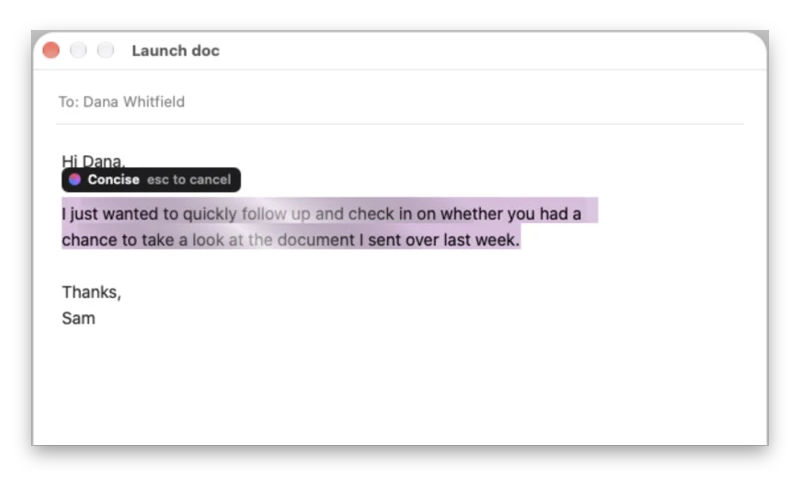
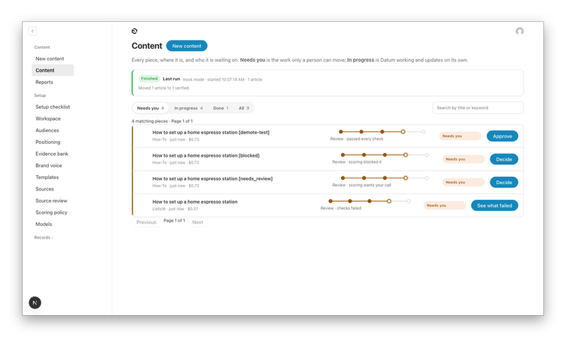
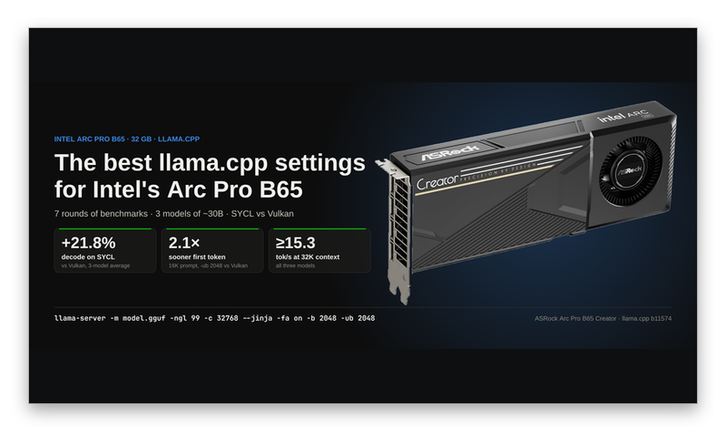
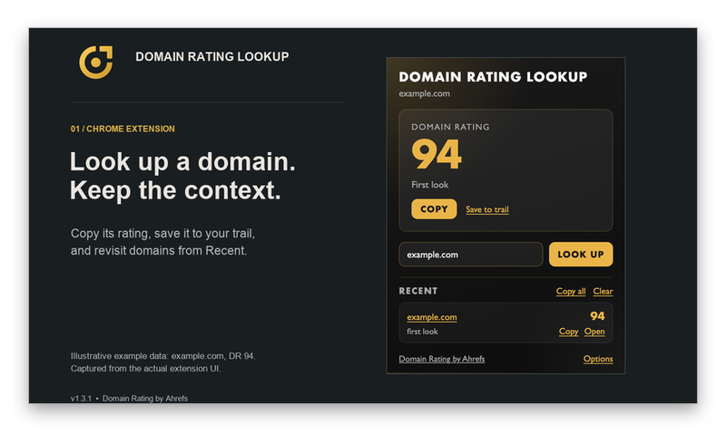
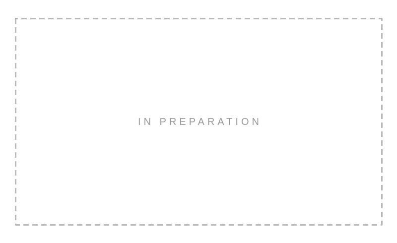

SNOWOPS &nbsp;·&nbsp; SELECTED WORKS, 2026

### AJ Nieves

Ten years in search. Now I build the tools. 
Five works on view, one in preparation.

 

<table>
<tr>
<td width="50%" valign="top">

 
NO. 01<!--new:loqui--><!--/new--> 
<b><a href="https://github.com/snowopsdev/loqui">Loqui</a></b>, 2026 
<i>Electron, C, and a microphone</i>

Local-first dictation, notes, and meetings, with a personal AI assistant. macOS and Linux.

<!--revised:loqui-->Last revised Oct 23<!--/revised-->
</td>
<td width="50%" valign="top">

 
NO. 02 &nbsp;·&nbsp; IN MOTION<!--new:selara--><!--/new--> 
<b><a href="https://github.com/snowopsdev/selara">Selara</a></b>, 2026 
<i>Rust and one global hotkey</i>

Select any text, press a key, get a rewrite you can review word by word. macOS.

<!--revised:selara-->Last revised Oct 8 &nbsp;·&nbsp; v0.7.0<!--/revised-->
</td>
</tr>
<tr>
<td width="50%" valign="top">

 
NO. 03<!--new:datum--><!--/new--> 
<b><a href="https://github.com/snowopsdev/datum">Datum</a></b>, 2026 
<i>TypeScript, Payload CMS, and an approval gate</i>

A governed content pipeline: research, generate, QA, then a person signs off.

<!--revised:datum-->Last revised Oct 22 &nbsp;·&nbsp; v0.8.0<!--/revised-->
</td>
<td width="50%" valign="top">

 
NO. 04<!--new:b65-benchmarks--> &nbsp;·&nbsp; NEW ACQUISITION<!--/new--> 
<b><a href="https://github.com/snowopsdev/b65-benchmarks">B65 Benchmarks</a></b>, 2026 
<i>llama.cpp, Python, and 32 GB of VRAM</i>

Seven rounds of local LLM benchmarks on Intel Arc Pro B65. SYCL vs Vulkan, raw runs included.

<!--revised:b65-benchmarks-->Last revised Oct 26<!--/revised-->
</td>
</tr>
<tr>
<td width="50%" valign="top">

 
NO. 05<!--new:dr-extension--><!--/new--> 
<b><a href="https://github.com/snowopsdev/dr-extension">DR Lookup</a></b>, 2026 
<i>JavaScript, Chrome, and the Ahrefs API</i>

Domain Rating for any site, one click away, with a trail of the ones you checked.

<!--revised:dr-extension-->Last revised Sep 18 &nbsp;·&nbsp; v1.3.0<!--/revised-->
</td>
<td width="50%" valign="top">

 
NO. 06 
<b>Next exhibit</b> 
<i>In preparation</i>

Something new is on the workbench. Follow along on <a href="https://x.com/snowopsdev">x.com/snowopsdev</a>.

</td>
</tr>
</table>

 

Open daily &nbsp;·&nbsp; Admission free &nbsp;·&nbsp; [snowops.dev](https://snowops.dev) &nbsp;·&nbsp; [x.com/snowopsdev](https://x.com/snowopsdev) &nbsp;·&nbsp; [LinkedIn](https://www.linkedin.com/in/ajnieves) &nbsp;·&nbsp; [aj@snowops.dev](mailto:aj@snowops.dev)
